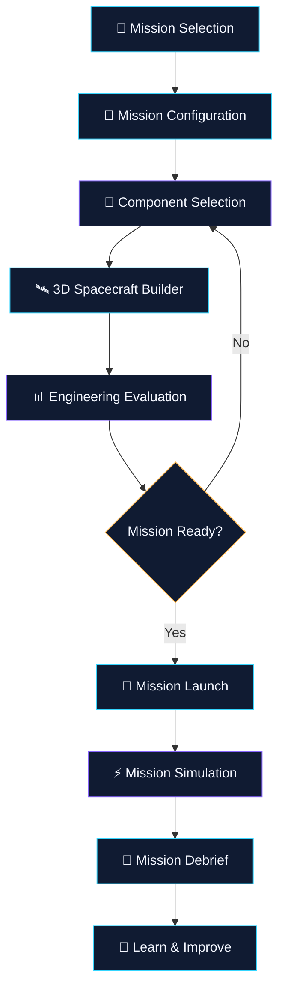
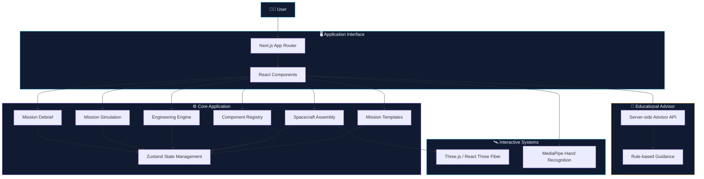

# COSMIC LABS — MISSION ARCHITECT

Build. Engineer. Launch. Discover.

COSMIC LABS is an educational space mission design game for the NASA Space Apps Challenge. Players select a destination, configure a mission, assemble a spacecraft from illustrative components, evaluate its engineering envelope, run a deterministic mission simulation, and review a debrief.# 🚀 COSMIC LABS — MISSION ARCHITECT

### Build. Engineer. Launch. Discover.

<p align="center">
  <strong>An Interactive Space Mission Design & Simulation Experience</strong>
  <br/>
  Built for the <strong>NASA Space Apps Challenge 2026</strong>
  <br/><br/>
  <em>Explore space. Design spacecraft. Make mission-critical decisions.</em>
</p>

---

## 🌌 About the Project

**COSMIC LABS** is an educational space mission design game that puts players in the role of a spacecraft mission architect.

What does it take to design a spacecraft capable of exploring another world?

Players select a destination, configure a mission, assemble a spacecraft using modular components, evaluate its engineering constraints, and launch a deterministic mission simulation.

Through interactive spacecraft visualization, engineering calculations, and mission decisions, COSMIC LABS makes complex aerospace concepts easier to explore and understand.

> Your mission. Your spacecraft. Your decisions. Your discovery.

---

## 🪐 Explore the Mission

The experience follows a complete spacecraft design and mission workflow.



### 🎮 Your Mission Journey

| Stage | What happens |
|---|---|
| 🌍 Mission Selection | Choose Mars, Moon, or asteroid exploration. |
| 🎯 Mission Configuration | Set mission name, objective, duration, budget, and difficulty. |
| 🧩 Component Selection | Add spacecraft modules from the centralized component library. |
| 🛰️ Spacecraft Assembly | Inspect a modular 3D spacecraft with orbit and zoom controls. |
| 📊 Engineering Evaluation | Monitor mass, power, battery, cost, and mission readiness. |
| 🧠 Mission Advisor | Ask NEBULA educational advisor questions. |
| 🚀 Mission Simulation | Launch a staged simulation and make resource-management decisions. |
| 📑 Mission Debrief | Review mission performance and explore NASA learning references. |

---

## ✨ Key Features

### 🌍 1. Mission Selection & Configuration

Choose your exploration destination:

- 🔴 Mars Exploration
- 🌕 Lunar Exploration
- ☄️ Asteroid Exploration

Configure your mission parameters, including objectives, duration, budget, and difficulty.

### 🛰️ 2. Interactive 3D Spacecraft Builder

Explore a modular spacecraft preview built with Three.js and React Three Fiber.

- Inspect spacecraft components.
- Visualize the assembled spacecraft.
- Orbit and zoom around the model.
- Work with a centralized component registry.

### 📊 3. Engineering Feasibility Engine

Every spacecraft design comes with engineering trade-offs.

COSMIC LABS evaluates:

- ⚖️ **Mass:** Total spacecraft mass.
- ☀️ **Power:** Power generation and consumption.
- 🔋 **Battery:** Stored energy capacity.
- 📡 **Communication:** Communication subsystem availability.
- 🚀 **Propulsion:** Mission-specific propulsion requirements.
- 💰 **Budget:** Total illustrative component cost.

The results help players understand whether their spacecraft meets the selected mission's simplified requirements.

### 🧠 4. NEBULA — Educational Mission Advisor

Have questions about your spacecraft?

The local NEBULA advisor provides rule-based educational guidance based on the application's engineering information.

- Understand feasibility warnings.
- Explore engineering trade-offs.
- Learn about spacecraft systems.
- Get suggestions for improving mission readiness.

No external AI API key is required.

### ✋ 5. Optional Hand Gesture Recognition

COSMIC LABS includes optional webcam-based hand-landmark recognition using MediaPipe Tasks Vision.

Currently recognized gesture states:

- 🖐️ Open palm
- 🤏 Pinch
- ✊ Closed fist

Camera access is activated explicitly by the user. Traditional mouse and keyboard interaction remain available.

### 🚀 6. Deterministic Mission Simulation

Take your spacecraft through a staged mission simulation.

Experience a resource-management decision and see how mission operations influence the simulation outcome.

### 📑 7. Mission Debrief & NASA Science Desk

Review your mission outcome and explore educational resources.

The Science Desk connects players with official NASA learning material related to spacecraft design and space exploration.

---

## 🧩 System Architecture

COSMIC LABS follows a modular architecture that separates engineering logic, mission data, application state, and user interface components.



### 📁 Project Structure

The application is organized into modular directories:

| Directory | Responsibility |
|---|---|
| `src/domain/` | Browser-independent TypeScript contracts |
| `src/missions/` | Centralized mission templates |
| `src/components/` | Reusable spacecraft component registry |
| `src/engineering/` | Deterministic feasibility calculations |
| `src/spacecraft/` | Converts component inventory into snapped spacecraft instances |
| `src/state/` | Persisted mission, design, simulation, and report state |
| `components/` | UI adapters and reusable interface components |
| `app/api/advisor/` | Server-side rule-based advisor endpoint |

**Architecture principle:** Engineering calculations and domain logic stay outside React UI components, making the application easier to maintain, test, and extend.

---

## ⚙️ Technology Stack

| Technology | Purpose |
|---|---|
| Next.js App Router | Application framework and routing |
| React | User interface |
| TypeScript | Type safety and maintainability |
| Zustand | Application state and browser persistence |
| Three.js | 3D graphics |
| React Three Fiber | React-based 3D rendering |
| Drei | 3D scene utilities |
| MediaPipe Tasks Vision | Hand-landmark recognition |
| Framer Motion | Interface animations |
| Custom CSS | Visual design system |

---

## 🔬 Engineering Assumptions

COSMIC LABS uses simplified educational calculations to demonstrate spacecraft engineering concepts.

| Parameter | Calculation / Rule |
|---|---|
| ⚖️ Mass | Sum of selected component masses |
| ☀️ Power Margin | Power generation − power consumption |
| 🔋 Battery | Stored energy measured in watt-hours (Wh) |
| 📡 Communication | Requires both a high-gain antenna and transceiver |
| 🚀 Propulsion | Simplified requirement for Mars and asteroid missions; optional for lunar missions |
| 💰 Budget | Sum of illustrative component credits |

### Important Scientific Disclaimer

The component values and engineering parameters are **fictional educational game values**.

They are not NASA hardware specifications, validated spacecraft performance data, or real-world mission design calculations.

COSMIC LABS is an educational simulation and does not certify spacecraft designs for actual flight operations.

---

## 🛰️ NASA Learning Resources

The project references official NASA educational material to support learning about spacecraft systems and mission design.

| Resource | Learning focus |
|---|---|
| [NASA State-of-the-Art Small Spacecraft Technology](https://www.nasa.gov/smallsat-institute/sst-soa/) | Small spacecraft technologies |
| [NASA JPL — Build a Satellite](https://www.jpl.nasa.gov/edu/resources/lesson-plan/build-a-satellite/) | Satellite components and design |
| [NASA Science — Basics of Space Flight](https://science.nasa.gov/learn/basics-of-space-flight/) | Spacecraft systems and mission concepts |
| [NASA JPL — Design Your Spacecraft](https://www.jpl.nasa.gov/edu/resources/collection/mission-to-mars-student-challenge/education-plan-design-your-spacecraft/) | Spacecraft design education |

Explore these references directly through the in-app **[Science Desk](/references)**.

*The project uses NASA educational resources for learning and reference. It does not claim to use NASA datasets.*

---

## 🛠️ Getting Started

Want to run COSMIC LABS locally?

### Prerequisites

- Node.js
- npm
- A modern web browser

### 1. Clone the repository

```bash
git clone <YOUR_GITHUB_REPOSITORY_URL>
```

### 2. Navigate to the project

```bash
cd <YOUR_PROJECT_DIRECTORY>
```

### 3. Install dependencies

```bash
npm install
```

### 4. Start the development server

```bash
npm run dev
```

### 5. Open the application

Visit:

```text
http://localhost:3000
```

You're ready to begin your mission! 🚀

---

## 🧪 Validation & Build

Run the following commands to validate the project.

**Type checking**

```bash
npm run typecheck
```

**Linting**

```bash
npm run lint
```

**Production build**

```bash
npm run build -- --webpack
```

---

## ✋ Optional Gesture Controls

Gesture recognition is an optional feature in the spacecraft design bay.

1. Select **Enable Camera**.
2. Grant camera permission when prompted.
3. Allow MediaPipe to initialize.
4. View recognized hand gestures.

### Reliability and fallback behavior

- Camera permission is requested only after user activation.
- MediaPipe model assets are loaded from a public CDN.
- The application handles unavailable cameras, denied permissions, and model-loading failures.
- Mouse and keyboard controls remain available.

**Current limitation:** Gesture recognition reports open-palm, pinch, and closed-fist states. It does not yet support dragging spacecraft modules through 3D placement space.

---

## 🚧 Current Limitations & Future Improvements

COSMIC LABS is an evolving educational project.

| Area | Current status / next improvement |
|---|---|
| 🛰️ 3D spacecraft | Uses generated primitive geometry rather than production spacecraft assets |
| ✋ Gesture interaction | Recognizes gestures but does not yet support 3D module dragging |
| 🧠 Mission advisor | Uses a deterministic rule-based fallback; a server-side Gemini adapter could be added |
| 🚀 Mission simulation | Deterministic educational state machine, not an orbital mechanics simulator |
| 🧪 Testing | Automated browser tests should be added |
| ☁️ Deployment | Deployment configuration and public-release validation remain to be completed |

### Future Possibilities

- More detailed modular spacecraft models.
- Gesture-based 3D component placement.
- More mission destinations and objectives.
- Expanded mission events and decision paths.
- More detailed educational engineering models.
- Automated end-to-end testing.

---

## 👩‍🚀 Team

**Team NebulaWorks**

Project: **COSMIC LABS — Mission Architect**

Created for the **NASA Space Apps Challenge 2026**.

---

<p align="center">
  <strong>🌌 COSMIC LABS</strong>
  <br/>
  <em>Build. Engineer. Launch. Discover.</em>
  <br/><br/>
  Every great mission begins with curiosity.
  <br/>
  <strong>What's yours?</strong>
</p>

## Current experience

1. Select Mars, Moon, or asteroid exploration.
2. Configure mission name, objective, duration, budget, and difficulty.
3. Add spacecraft modules from the centralized component registry.
4. Inspect the modular 3D spacecraft preview with orbit and zoom controls.
5. Review live mass, power, battery, cost, and readiness metrics.
6. Run deterministic feasibility checks and ask the local NEBULA educational advisor questions.
7. Launch a staged simulation with a resource-management decision.
8. Review the mission debrief and explore NASA learning references.

## Technology

- Next.js App Router, React, TypeScript, and strict type checking
- Zustand with browser persistence for mission/design state
- Three.js, React Three Fiber, and Drei for the spacecraft preview
- MediaPipe Tasks Vision for optional hand-landmark recognition
- Framer Motion and a custom CSS design system

## Architecture

- `src/domain/` contains browser-independent TypeScript contracts.
- `src/missions/` contains centralized mission templates.
- `src/components/` contains the reusable spacecraft component registry.
- `src/engineering/` contains deterministic feasibility calculations.
- `src/spacecraft/` converts inventory counts to snapped spacecraft instances.
- `src/state/` owns persisted mission, design, simulation, and report state.
- `components/` contains UI adapters only; calculations remain outside React components.
- `app/api/advisor/` exposes a server-side rule-based advisor endpoint. No API key is required.

## Engineering assumptions

The game uses simplified educational calculations:

- Mass is the sum of selected component masses.
- Instantaneous power margin is generation minus consumption in watts.
- Battery capacity is stored energy in watt-hours and is not treated as power.
- Communications require both the high-gain antenna and transceiver.
- Mars and asteroid missions use a simplified propulsion requirement; lunar propulsion is optional.
- Budget is the sum of illustrative component credits.

These values are explicitly fictional game parameters. They are not NASA hardware specifications and do not certify a real mission.

## NASA references consulted

- [NASA State-of-the-Art Small Spacecraft Technology](https://www.nasa.gov/smallsat-institute/sst-soa/)
- [NASA JPL: Build a Satellite](https://www.jpl.nasa.gov/edu/resources/lesson-plan/build-a-satellite/)
- [NASA Science: Basics of Space Flight](https://science.nasa.gov/learn/basics-of-space-flight/)
- [NASA JPL: Design Your Spacecraft](https://www.jpl.nasa.gov/edu/resources/collection/mission-to-mars-student-challenge/education-plan-design-your-spacecraft/)

The in-app [Science Desk](/references) links directly to these official resources. COSMIC LABS does not claim to use NASA datasets.

## Local setup

```bash
npm install
npm run dev
```

Open `http://localhost:3000`.

## Validation

```bash
npm run typecheck
npm run lint
npm run build -- --webpack
```

## Optional gesture controls

The design bay includes an explicit Enable camera control. Permission is requested only after activation. MediaPipe model assets are loaded from their public CDN, and the feature fails safely when a camera, permission, or model is unavailable. Mouse and keyboard interaction remain available.

## Limitations and next improvements

- The 3D scene uses generated primitive geometry rather than production spacecraft assets.
- Gesture recognition currently reports open-palm, pinch, and closed-fist states; it does not yet drag modules through 3D placement space.
- The advisor uses a deterministic fallback so the app works without Gemini credentials. A Gemini adapter can be added server-side without exposing secrets.
- The simulation is a deterministic educational state machine, not orbital mechanics or a certified mission simulator.
- Automated browser tests and deployment configuration should be added before public release.
